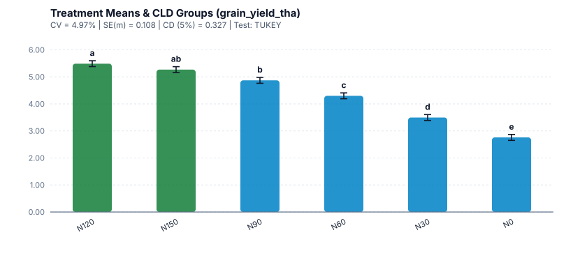
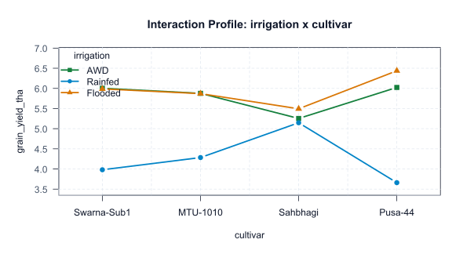
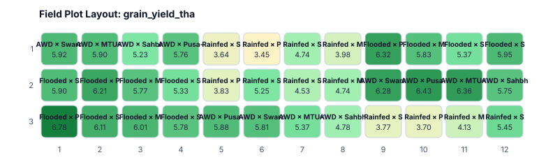
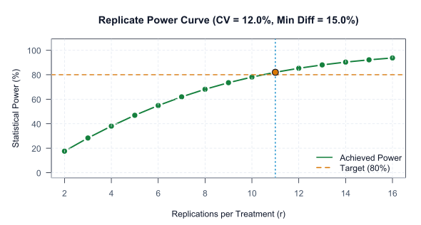

# 🌾 Serverless Field Trial Analyser (Shinylive / webR)

**A Zero-Cost, Browser-Native Agricultural Field Trial Analysis Suite — Powered by R, Shiny, and Shinylive (webR) on GitHub Pages**

[-15803D?style=for-the-badge&logo=r)](https://lunganlungpg.github.io/field-trial-analyser/)
[](https://github.com/lunganlungpg/field-trial-analyser/actions/workflows/deploy-shinylive.yml)
[](https://github.com/lunganlungpg/field-trial-analyser/actions/workflows/ci.yml)
[](LICENSE)
[](#architecture--why-serverless-webr)

Designed for **applied agricultural researchers, agritech field teams, and university teaching**, this project runs a complete statistical R runtime **100% client-side inside your web browser via WebAssembly (`webR`)**. There is no Shiny Server to pay for, no R/RStudio installation required for students or agronomists, and **unpublished trial spreadsheets never leave the user's device**.

---

## ✨ End-to-End Product Capabilities (Zero-Code UX)

1. **Three Frictionless Ways to Bring Field Data**
   - **5 Curated Agronomic Demo Datasets**: Wheat Nitrogen RCBD, Rice Irrigation × Cultivar Split-Plot, Indian Mustard Variety × Sulphur Factorial RCBD, Chickpea Bio-Fertilizer CRD, and Sugarcane 5×5 Latin Square.
   - **Upload CSV / TSV** with downloadable blank templates.
   - **Direct Paste from Excel / Google Sheets** with automatic tab/comma/semicolon delimiter detection.
2. **Pre-Flight Data Health Check & Smart Column Auto-Mapping**
   - Automatically identifies response traits, treatment/block/row/column factors, checks missing plots and balance, verifies $t \times t$ Latin Square orthogonality, and explains issues in plain English before running ANOVA.
3. **Five Core Experimental Designs with Exact Agronomy Partitioning**
   - **CRD** (Completely Randomized Design)
   - **RCBD / RBD** with **Cochran & Cox Relative Efficiency vs. CRD (%)**
   - **Latin Square Design (LSD)** controlling simultaneous row & column gradients
   - **Two-Way Factorial RCBD** with main effects, A × B interaction profile, and cell means
   - **Split-Plot Design** with exact dual error partitioning (**Error (a)** = Block × Main Plot, **Error (b)** = Sub-Plot Residual), `CV(a)%`, `CV(b)%`, and all 4 Gomez & Gomez `SEm` / `SEd` / `CD` comparison rows
4. **Multiple Comparisons & Piepho (2004) Compact Letter Display (CLD)**
   - **Tukey HSD**, **Fisher's Protected LSD / Critical Difference (CD)**, and **Bonferroni**
   - Exact insert-absorb grouping letters (`a`, `ab`, `b`, ...) computed in pure base R
5. **Smart Transformation Advisor & Field Spatial Diagnostics**
   - Side-by-side comparison of **Raw**, **Log(`y + 1`)**, **Square-Root(`y + 0.5`)**, and **Arcsine / Angular (`%`)** with Shapiro-Wilk normality, Brown-Forsythe homoscedasticity, and 1-click **"Apply Recommended Transform"**
   - **Outlier Watchlist** (`|Std Resid| > 2.5` or high Cook's D) and **Interactive Spatial Field Map** (hover over plot tiles to inspect fertility drift and residuals)
6. **Teaching Lab, Replicate Power Planner & One-Click Exports**
   - Interactive pre-planting **Replicate / Power Calculator** (non-central *t* power curve across replications)
   - **Copy-Ready Plain-English Interpretation** paragraph for manuscripts and theses
   - Client-side downloads: **Standalone HTML Report (with inline SVG plots)**, **Means & CLD CSV**, **ANOVA CSV**, and a **Reproducible Base-R Script (`.R`)**

---

## 📊 Visual Highlights (Generated Directly by the `fieldtrial` Engine)

### 1. Treatment Comparison & Compact Letter Display (`wheat_rcbd_gomez.csv`)
In the Wheat Nitrogen RCBD trial ($N = 24$ plots, `CV = 4.97%`, `SE(m) = 0.108`, `CD 5% = 0.327`), blocking achieved **229.1% Relative Efficiency** over an unblocked CRD. `N120` (`5.490 t/ha`, group `a`) and `N150` (`5.270 t/ha`, group `ab`) are statistically at par under Tukey HSD ($\alpha = 0.05$).



### 2. Split-Plot Crossover Interaction & Spatial Field Layout (`rice_split_plot.csv`)
Under Split-Plot partitioning (`CV(a) = 11.40%`, `CV(b) = 3.31%`), the irrigation × cultivar interaction is highly significant ($p = 8.73 \times 10^{-9}$): `Pusa-44` leads under `Flooded` (`6.44 t/ha`, `a`), whereas drought-resilient `Sahbhagi` leads under `Rainfed` stress (`5.15 t/ha`, `c`, vs. `3.66 t/ha` for `Pusa-44`).





### 3. Pre-Planting Replicate & Power Planner
Given an expected field `CV = 12%` and minimum meaningful difference of `15%` across `6` treatments in an RCBD ($\alpha = 0.05$, target power `80%`), the planner identifies **$r = 11$ replications** (`66` total plots, achieving `82.0%` power).



---

## 🏗️ Architecture & Why Serverless webR

```text
field-trial-analyser/
├── app/                         # Standalone Shinylive bundle deployed to GitHub Pages
│   ├── app.R                    # Guided 5-tab bslib UI + server (shiny + bslib only)
│   ├── R/                       # Mirrored pure base-R engine (auto-sourced / fallback-sourced)
│   ├── data/                    # 5 curated agronomic CSV datasets
│   └── www/styles.css           # Accessible light/dark agricultural styling
├── R/                           # Installable zero-dependency R package `fieldtrial`
│   ├── datasets.R               # Sample trial catalog & cross-environment loader
│   ├── validation.R             # Delimiter/Excel parser, column detector, pre-flight checks, transforms
│   ├── anova_engine.R           # CRD, RCBD, LSD, Factorial, Split-Plot ANOVA, Piepho CLD & diagnostics
│   ├── power_planner.R          # Non-central t replication & power planner
│   ├── plotting.R               # Base-R plots + pure-R vector SVG generators
│   └── reporting.R              # Reproducible R script & self-contained HTML report generator
├── inst/extdata/                # Package datasets (parity-verified against app/data/)
├── tests/
│   ├── run_tests.R              # Zero-dependency full engine, Split-Plot aov() cross-check & parity suite
│   └── test-package.R           # Package check script executed by R CMD check
├── scripts/
│   └── generate_readme_plots.R  # Regenerates vector SVGs into plots/
├── plots/                       # Publication-ready vector SVG figures
├── .github/workflows/
│   ├── deploy-shinylive.yml     # Exports app/ via shinylive::export() and deploys to GitHub Pages
│   └── ci.yml                   # Runs tests/run_tests.R, R CMD INSTALL & R CMD check
├── DESCRIPTION, NAMESPACE, man/ # Standard R package metadata & documentation
└── LICENSE                      # MIT License
```

### Key Engineering Decisions for Reliable Browser Deployment
- **Minimal WASM Footprint (`shiny` + `bslib` only):** Keeping all statistical routines, Piepho CLD, Brown-Forsythe homoscedasticity, power curves, and inline SVG report charts in **pure base R** avoids downloading 30–50 MB of transitive C/C++ WASM dependencies (`agricolae`, `car`, `ggplot2`), ensuring fast browser startup and zero broken WebAssembly binary builds.
- **Deterministic Parity:** `tests/run_tests.R` verifies byte-for-byte parity between `R/` and `app/R/` as well as `inst/extdata/` and `app/data/`, and cross-checks Split-Plot `Error(a)` / `Error(b)` F-ratios directly against base R's `stats::aov(..., Error(blk/mp))`.

---

## 🚀 Quickstart

### Option 1: Use Live in Browser (Zero Install)
Open the GitHub Pages deployment:
👉 **[https://lunganlungpg.github.io/field-trial-analyser/](https://lunganlungpg.github.io/field-trial-analyser/)**

### Option 2: Run the Shiny App Locally
```r
install.packages(c("shiny", "bslib"))
shiny::runApp("app")
```

### Option 3: Export Static Shinylive Site Locally
```r
install.packages("shinylive")
shinylive::export("app", "_site")
httpuv::runStaticServer("_site")
```

### Option 4: Install & Use the Zero-Dependency `fieldtrial` R Package
```r
# Install straight from GitHub (base R only — zero runtime dependencies)
remotes::install_github("lunganlungpg/field-trial-analyser")

library(fieldtrial)
df  <- load_sample_trial("wheat_rcbd")
res <- analyse_field_trial(df, design = "rcbd", mapping = detect_trial_columns(df))
res$anova_table
res$means_table
cat(generate_interpretation_text(res))
```

### Run Local Tests
```bash
Rscript tests/run_tests.R
```

---

## 📚 References & Methodological Foundations

- Gomez, K. A., & Gomez, A. A. (1984). *Statistical Procedures for Agricultural Research* (2nd ed.). John Wiley & Sons.
- Cochran, W. G., & Cox, G. M. (1957). *Experimental Designs* (2nd ed.). John Wiley & Sons.
- Piepho, H.-P. (2004). An algorithm for a letter-based representation of all-pairwise comparisons. *Journal of Computational and Graphical Statistics*, 13(2), 456–466.

---

## 👤 Author & License

**Lunganlung P. G.** — Division of Agricultural Statistics, ICAR–Indian Agricultural Statistics Research Institute (IASRI), New Delhi.  
Released under the [MIT License](LICENSE).
